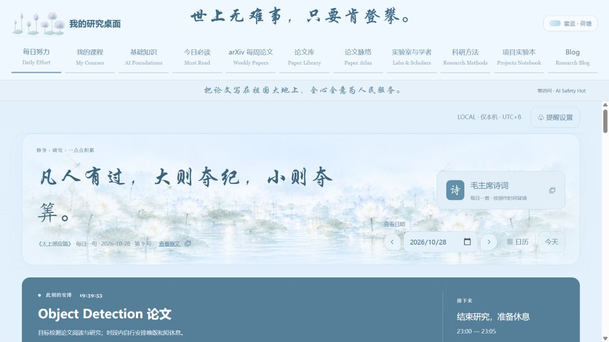

# 雾蓝荷塘 · 科研工作台（中文版）

一个在本机运行的中文科研工作台，将论文阅读、课程学习、研究问题、笔记、项目和每日日程放在一起。界面采用雾蓝色与荷塘背景，支持圆角卡片和分栏阅读。

## 每日努力页面展示



## 快速启动

安装 Python 3.11 或更新版本，下载本仓库后，在项目根目录运行：

```sh
python run.py
```

浏览器打开 http://127.0.0.1:8869/#daily 。

只启动服务、不自动打开浏览器：

```sh
python run.py --no-browser
```

预览时暂不执行自动 arXiv 采集：

```sh
python run.py --preview --no-browser
```

这是带 Python 和 SQLite 后端的本地应用。GitHub 保存项目源码，下载后可在自己的电脑上运行。

## 主要功能

| 模块 | 可以做什么 |
| --- | --- |
| 每日努力 | 日程模板、待办事项、子任务与每周记录 |
| arXiv 论文观测台 | 浏览论文、星图、时间线与每日归档 |
| 论文库 | 按研究方向、会议和年份整理论文 |
| 论文阅读 | 左侧阅读 PDF，右侧填写阅读任务、笔记与问题 |
| 论文脉络 | 整理主题、问题、方法与关联论文，进行对比阅读 |
| 我的课程 | 管理基础课程、科研课程和自研课程 |
| 基础知识 | 整理模型、训练、推理和部署知识 |
| 实验室与学者 | 维护学者、实验室与相关论文 |
| 科研方法 | 保存科研方法与学习资料 |
| 项目实验本 | 记录研究问题、实验、证据与下一步 |
| Blog | 按分类和时间管理研究笔记 |

## 上传与阅读自己的文档

在「论文库 → 添加论文」中拖入 PDF，填写或核对标题、作者、年份、会议等信息，然后点击「保存并开始阅读」。

每课支持 PDF、Word 和 PowerPoint 附件，也支持拖拽上传。单个文件上限为 50 MB。PDF 可以在站内阅读，Office 文档预览或转换需要相应本地工具。

## 数据保存在自己的电脑

首次启动会创建本副本的空白运行数据库，数据保存在 `sites/mist-blue-lotus/app/local-data/`。上传文件、课程内容、笔记和阅读进度均由使用者自行添加。

本仓库发布应用源码和界面素材，发布包不含作者的私人数据库、课程材料、论文记录、笔记、上传文档或每日新闻。运行数据目录已通过 Git 忽略规则排除。

默认使用 8866—8870 端口。arXiv 采集、外部论文下载和可选 Zotero 连接需要网络或相应本地配置。

## 项目目录

| 目录 | 内容 |
| --- | --- |
| `sites/mist-blue-lotus/app/` | 完整应用源码 |
| `sites/mist-blue-lotus/run.py` | 服务启动器 |
| `scripts/` | 发布检查工具 |
| `tests/` | 回归检查 |
| `docs/` | 运行与发布说明 |

## 验证

```sh
python scripts/check_full_release.py
python scripts/run_site_checks.py
```

本仓库为独立中文版，英文版位于 [ResearchStarterKit](https://github.com/Hahappyppy2024/ResearchStarterKit)。
